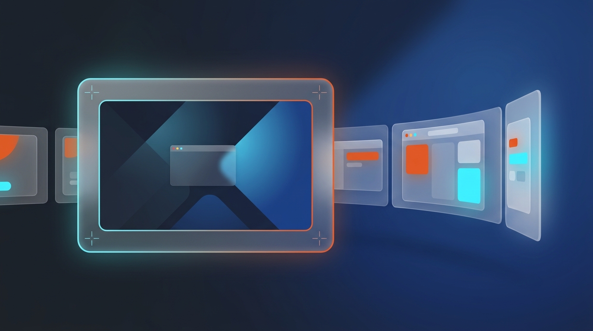

# VeloShot



[Deutsch](#deutsch) · [English](#english)

---

## Deutsch

Ein schnelles, flüssiges Screenshot-Werkzeug in **Rust** mit **GTK4 + Libadwaita**, speziell entwickelt für **Ubuntu Wayland (GNOME)** — inklusive automatischer Tastenkürzel-Erkennung für **GNOME**, **KDE Plasma**, **XFCE** und **Sway**.

### Funktionen

- **Greenshot-ähnliche Bereichsaufnahme & schwebende Mini-Leiste:** GPU-gerendertes Vollbild-Overlay über `xdg-desktop-portal` (`ashpd`) mit Vollbild-Fadenkreuz, **6×-Live-Lupe** und transparenter Mini-Leiste (**Auswahl**, **Monitor-Auswahl** mit Live-Hervorhebung, **Fenster** über GNOME-Portal, **3s/5s-Timer** sowie **Oben/Unten-Wechsel**), die beim Ziehen automatisch ausgeblendet wird.
- **Interaktives 60+ FPS Verlaufs-Karussell:** Große Live-Vorschau mit **5 % transparentem Außenrand**, Datum und Metadaten kompakt unten links, animiertem Oben/Unten-Wechsel und flüssiger Steuerung per Tastatur, Mausrad oder Trackpad. Konfigurierbare Position: **Oben**, **Unten** oder **Zentral**.
- **Integrierter Annotations- & Bearbeitungs-Editor:**
  - **Auswählen & Verschieben** (`V`, `Entf` zum Löschen, Doppelklick auf Text/Sprechblase zum direkten Nachbearbeiten)
  - **Rechteck** (`1`), **Pfeil** (`2`), **Kreis / Ellipse** (`3`), **Textmarker** (`4`), **Freihand** (`5`), **Nummerierte Schritte 1-2-3** (`6`)
  - **Text** (`7`), **Sprechblase** (`8`), **Verpixeln / Schwärzen** (`9`), **Fokus / Spotlight** (`0`), **Zuschneiden / Crop** (`C`)
  - **Hintergrundfüllungen** für Formen/Text/Sprechblasen, **90°-Drehung & Spiegeln**, **Beautify-Rahmen** (Farbverlauf, abgerundete Ecken, Schlagschatten) sowie optionale **Offline-Texterkennung (OCR)** per `tesseract` direkt in die Zwischenablage
  - **Skalierbare Icon- & Button-Größen** (**Klein**, **Mittel**, **Groß**), **Auto-Copy** in die Wayland-Zwischenablage, **Zoom** (`Strg+Mausrad` / `-`, `100%`, `+`), **Rückgängig/Wiederholen** (`Strg+Z` / `Strg+Y`), Kopieren (`Strg+C`) und Exportieren (`Strg+S`).
- **Einstellungen, Export & 17 europäische Sprachen:**
  - **Sprachen:** **Automatisch (Systemsprache)** plus **17 europäische Sprachen** (`English`, `Deutsch`, `Ελληνικά`, `Français`, `Español`, `Nederlands`, `Italiano`, `Português`, `Polski`, `Svenska`, `Dansk`, `Norsk`, `Suomi`, `Čeština`, `Magyar`, `Română`, `Українська`) mit sofortigem Live-Wechsel in den Einstellungen.
  - **Export & Dateinamen:** Wahl zwischen **PNG (Verlustfrei)** und **JPEG (Kleinere Datei)** (mit automatischem Alpha-Blending auf Weiß), Standard-Dateinamensmuster `<year>-<month>-<day>_<hour>-<minute>-<second>_Screenshot` (weitere Platzhalter: `<width>`, `<height>`), Standardordner (`~/Bilder/VeloShot` bzw. `~/Pictures/VeloShot`) und Verlaufs-Limit (`1..=200`).
  - **Desktop-Tastenkürzel:** Automatische Erkennung und Einrichtung für **GNOME** (`gsettings`), **KDE Plasma**, **XFCE** und **Sway** inkl. komfortablem Schalter für die `Druck`-Taste.

### Systemvoraussetzungen (Ubuntu)

Für den Build aus den Quellen werden GTK4- und Libadwaita-Header benötigt (`tesseract-ocr` ist optional für OCR):

```bash
sudo apt update && sudo apt install -y libgtk-4-dev libadwaita-1-dev
# Optional für Offline-OCR:
sudo apt install -y tesseract-ocr tesseract-ocr-deu
```

### Build & lokale Installation

```bash
cargo test
cargo build --release
./install-local.sh              # Baut Release, beendet alten Daemon, installiert nach ~/.local & startet neu
```

Weitere Optionen für [`install-local.sh`](install-local.sh):

```bash
./install-local.sh --skip-build # Vorhandene target/release/veloshot ohne Neubau installieren
./install-local.sh --symlink    # ~/.local/bin/veloshot auf target/release/veloshot verlinken
```

### CLI-Befehle

```bash
veloshot           # Bereichsaufnahme direkt starten + Tray-Icon aktiv halten
veloshot capture   # Bereichsaufnahme sofort starten
veloshot history   # Verlaufs-Karussell öffnen
veloshot window    # Hauptfenster öffnen
veloshot settings  # Einstellungen öffnen
veloshot daemon    # Hintergrunddienst (Tray-Icon) still starten
veloshot quit      # Laufende Hintergrundinstanz sauber beenden
veloshot --log     # GLib/GTK-Warnungen nach ~/.local/state/veloshot/app.log schreiben (oder VELOSHOT_LOG=1)
veloshot --help    # Hilfe anzeigen
```

### Tastenkürzel in der App

- **Aufnahme-Overlay:** Ziehen zum Auswählen, `Enter` für Vollbild, `Esc` oder Rechtsklick zum Abbrechen.
- **Karussell:** `Links`/`Rechts` (oder `Hoch`/`Runter`) navigieren, `Enter` / `Strg+C` kopieren, `E` im Editor öffnen, `Strg+S` speichern, `Entf` löschen, `N` neue Aufnahme, `,` Einstellungen, `Esc` schließen.
- **Editor:** `V` Auswählen/Verschieben (`Entf` löscht), `1` Rechteck, `2` Pfeil, `3` Ellipse, `4` Textmarker, `5` Freihand, `6` Schritte (1-2-3), `7` Text, `8` Sprechblase, `9` Verpixeln, `0` Spotlight, `C` Zuschneiden, `Strg+Mausrad` Zoom, `Strg+Z` / `Strg+Y` Rückgängig/Wiederholen, `Strg+C` Kopieren, `Strg+S` Exportieren, `Esc` Schließen.

### Snap-Paket & Branding-Assets

```bash
snapcraft pack
```

- **App-Icon (SVG):** `data/icons/hicolor/scalable/apps/io.github.konnospb.VeloShot.svg`
- **Symbolisches Icon:** `data/icons/hicolor/symbolic/apps/io.github.konnospb.VeloShot-symbolic.svg`
- **Logo & Store-Banner:** `data/branding/logo.png`, `data/branding/store-banner.png`

---

## English

A fast, fluid screenshot tool written in **Rust** with **GTK4 + Libadwaita**, specifically designed for **Ubuntu Wayland (GNOME)** — with automatic shortcut setup for **GNOME**, **KDE Plasma**, **XFCE**, and **Sway**.

### Features

- **Greenshot-Style Region Capture & Floating Mini-Bar:** Fullscreen GPU-rendered overlay via `xdg-desktop-portal` (`ashpd`) with full-screen crosshair, **6× live zoom loupe**, and a translucent floating mini-bar (**Selection**, per-**Monitor** picker with live hover highlight, **Window** via GNOME portal, **3s/5s** timer, and **Top/Bottom** flip) that auto-fades while dragging.
- **Interactive 60+ FPS Carousel History:** Full-size live preview with a **5% translucent outer border**, date and metadata neatly grouped at the bottom-left, animated top/bottom dock flip, and smooth keyboard/wheel/trackpad browsing. Configurable placement: **Top**, **Bottom**, or **Center**.
- **Built-in Annotation & Manipulation Studio:**
  - **Select & Move** (`V`, `Delete` to remove selected object, double-click Text/Speech Bubble for inline editing)
  - **Rectangle** (`1`), **Arrow** (`2`), **Circle / Ellipse** (`3`), **Highlighter** (`4`), **Freehand** (`5`), **Numbered Steps 1-2-3** (`6`)
  - **Text** (`7`), **Speech Bubble** (`8`), **Pixelate / Redact** (`9`), **Spotlight** (`0`), **Crop** (`C`)
  - **Background Fills** for shapes/text/bubbles, **Rotate 90° & Flip**, **Beautify Frame** (gradient backdrop, rounded corners, drop shadow), and optional offline **OCR** (`tesseract` text extraction to clipboard)
  - **Scalable Icon & Button Sizes** (**Small**, **Medium**, **Large**), **Auto-copy to Wayland Clipboard**, **Zoom** (`Ctrl+Scroll` / `-`, `100%`, `+`), **Undo/Redo** (`Ctrl+Z` / `Ctrl+Y`), clipboard copy (`Ctrl+C`), and export (`Ctrl+S`).
- **Preferences, Export & 17 European Languages:**
  - **Languages:** **Auto (System Locale)** plus **17 European languages** (`English`, `Deutsch`, `Ελληνικά`, `Français`, `Español`, `Nederlands`, `Italiano`, `Português`, `Polski`, `Svenska`, `Dansk`, `Norsk`, `Suomi`, `Čeština`, `Magyar`, `Română`, `Українська`) with instant live switching in Preferences.
  - **Export & Naming:** Choose between **PNG (Lossless)** and **JPEG (Smaller file)** (with automatic alpha compositing onto white), date-first default filename pattern `<year>-<month>-<day>_<hour>-<minute>-<second>_Screenshot` (plus `<width>`, `<height>`), custom save folder (defaults to `~/Pictures/VeloShot` / `~/Bilder/VeloShot`), and history limit (`1..=200`).
  - **Desktop Shortcuts:** Automatic detection and configuration for **GNOME** (`gsettings`), **KDE Plasma**, **XFCE**, and **Sway**, including a one-click `Print` key redirect toggle.

### System Prerequisites (Ubuntu)

GTK4 and Libadwaita development headers are required to build from source (`tesseract-ocr` is optional for editor OCR):

```bash
sudo apt update && sudo apt install -y libgtk-4-dev libadwaita-1-dev
# Optional offline OCR support:
sudo apt install -y tesseract-ocr tesseract-ocr-deu
```

### Build & Local Desktop Installation

```bash
cargo test
cargo build --release
./install-local.sh              # Builds release, stops old daemon, installs to ~/.local & restarts daemon
```

Additional flags for [`install-local.sh`](install-local.sh):

```bash
./install-local.sh --skip-build # Install existing target/release/veloshot without rebuilding
./install-local.sh --symlink    # Symlink ~/.local/bin/veloshot to target/release/veloshot
```

### CLI Commands

```bash
veloshot           # Start region capture directly + keep tray active
veloshot capture   # Start region capture immediately
veloshot history   # Open carousel history
veloshot window    # Open main hub window
veloshot settings  # Open preferences dialog
veloshot daemon    # Start tray icon quietly in background
veloshot quit      # Stop running background instance cleanly
veloshot --log     # Write GLib/GTK warnings to ~/.local/state/veloshot/app.log (or VELOSHOT_LOG=1)
veloshot --help    # Show CLI help
```

### Keyboard Shortcuts Inside the App

- **Capture Overlay:** Drag to select, `Enter` for fullscreen, `Esc` or right-click to cancel.
- **Carousel:** `Left`/`Right` (or `Up`/`Down`) to navigate, `Enter` / `Ctrl+C` to copy, `E` to edit, `Ctrl+S` to save, `Delete` to remove, `N` for new capture, `,` for settings, `Esc` to close.
- **Editor:** `V` Select/Move (`Delete` remove), `1` Rectangle, `2` Arrow, `3` Ellipse, `4` Highlighter, `5` Freehand, `6` Step Badges (1-2-3), `7` Text, `8` Speech Bubble, `9` Pixelate/Blur, `0` Spotlight, `C` Crop, `Ctrl+Scroll` Zoom, `Ctrl+Z` / `Ctrl+Y` Undo/Redo, `Ctrl+C` Copy, `Ctrl+S` Export, `Esc` Close.

### Snap Packaging & Branding Assets

```bash
snapcraft pack
```

- **App Icon (SVG):** `data/icons/hicolor/scalable/apps/io.github.konnospb.VeloShot.svg`
- **Symbolic Icon:** `data/icons/hicolor/symbolic/apps/io.github.konnospb.VeloShot-symbolic.svg`
- **Logo & Store Banner:** `data/branding/logo.png`, `data/branding/store-banner.png`

---

## License / Lizenz

Licensed under the [MIT License](LICENSE).
